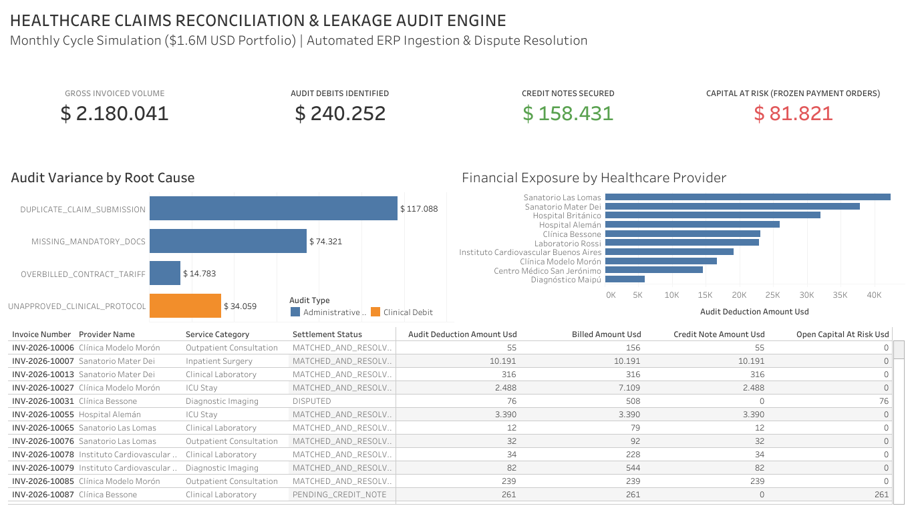

# Healthcare Provider Billing Discrepancy & Revenue Leakage Audit Engine
**End-to-End SQL Auditing Pipeline & Executive Settlement Dashboard ($1.6M Portfolio Simulation)**

[👉 View Live Interactive Tableau Dashboard](https://public.tableau.com/views/HealthcareClaimsDisputeSettlementAuditEngine/Dashboard?:language=es-ES&:sid=&:redirect=auth&:display_count=n&:origin=viz_share_link)

---

## 📌 Executive Summary
In institutional healthcare administration, operational errors, unapproved clinical protocols, and duplicate submissions represent significant financial leakage. This project simulates an enterprise-level claims reconciliation and audit enforcement lifecycle modeled on an active **$1.6M+ USD monthly settlement portfolio** (~700 complex claims across 150+ healthcare providers and hospital systems).

The pipeline covers three critical phases:
1. **Intake & Ingestion:** Simulating digital invoice intake and ERP ledger ingestion across a rolling monthly cycle (11th to 10th).
2. **Audit Variance Enforcement:** Ingesting Day 30 clinical and administrative audit debit directives to intercept non-compliant charges before disbursement.
3. **Dispute Resolution & Ledger Settlement:** Matching required debit adjustments with third-party Credit Notes (*notas de crédito*), freezing unauthorized Payment Orders (OPs), and protecting cash flow.

---

## 📊 Executive Dashboard Preview
The interactive BI layer was designed and published in **Tableau Public**, visualizing financial liabilities, provider risk profiles, and active dispute pipelines.

👉 **[Access the Full Interactive Tableau Dashboard Here](https://public.tableau.com/views/HealthcareClaimsDisputeSettlementAuditEngine/Dashboard?:language=es-ES&:sid=&:redirect=auth&:display_count=n&:origin=viz_share_link)**

### Key Cycle Metrics (Monthly Simulation Run)
- **Gross Invoiced Volume:** $2,180,041 USD across 700 claims.
- **Audit Debits Identified (Intercepted Leakage):** $240,252 USD (~11.0% variance rate).
- **Credit Notes Secured & Reconciled:** $158,431 USD (65.9% recovery rate).
- **Open Capital at Risk (Frozen Payment Orders):** $81,821 USD currently protected from disbursement pending provider compliance.

---

## 🛠️ Technical Stack & Tooling
- **Data Warehousing & Querying:** Google BigQuery (Standard SQL)
- **Business Intelligence & Visualization:** Tableau Public
- **Core Techniques:** Multi-table Joins, Common Table Expressions (CTEs), Window Functions (`DENSE_RANK`), Conditional Aggregations, Data Cleaning.

---

## 📁 Repository Structure
├── data/
│   ├── dim_providers.csv                # Master vendor data
│   ├── fact_claims_invoiced.csv         # Invoiced claims transactions
│   ├── fact_audit_findings.csv          # Audit debit directives
│   └── fact_credit_notes_settlement.csv # Offset credit note records
├── sql/
│   ├── 01_schema_definition.sql         # DDL table creation statements
│   ├── 02_audit_discrepancy_queries.sql # Core operational audit scripts
│   └── 03_reporting_view.sql            # Master analytical view for BI
├── dashboard/
│   └── dashboard_preview.png            # Static preview of Tableau UI
└── README.md                            # Project documentation

---

## 👤 Author & Contact
**Lucas Monzon**  
*Healthcare Claims & Operations Analyst | Financial Reconciliation & Audit*  
- **LinkedIn:** [linkedin.com/in/lucasmonzon1](https://linkedin.com/in/lucasmonzon1)
- **GitHub:** [github.com/lucasmonzon1](https://github.com/lucasmonzon1)
- **Email:** lucasemonzon@hotmail.com
